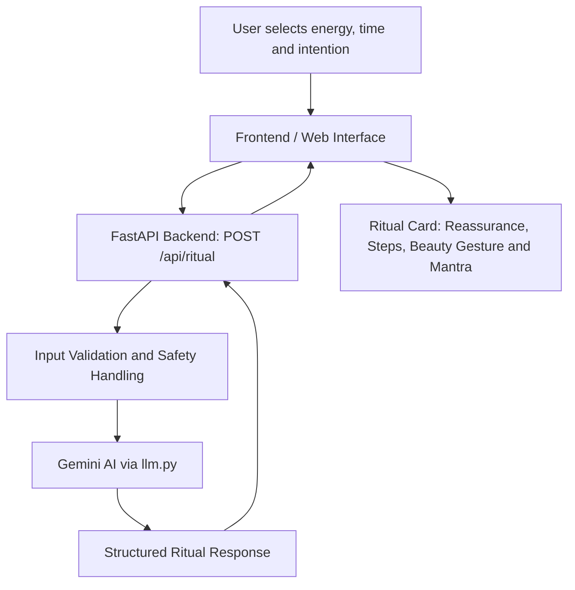

# Soi Sacré — Architecture

## MVP Request Flow

## Main Components

- **Frontend:** The planned user interface, based on the Figma prototype, collects the user's choices and displays the generated ritual.
- **FastAPI Backend (`main.py`):** Receives requests through `/api/ritual` and returns structured ritual data.
- **AI Integration (`llm.py`):** Connects to Gemini to generate personalized self-care rituals.
- **Safety Documentation (`guardrails.md`, `guardrails.py`):** Documents and supports safe handling of user input and sensitive situations.
- **Schema (`schema.json`):** Defines the expected structure of the ritual data.
- **Examples (`examples.json`):** Contains eight real API input/output examples for testing and review.
- **Ritual Card:** Presents the ritual title, reassurance, steps, beauty gesture, and mantra.

## Current Implementation Status

The FastAPI backend and Gemini integration have been tested successfully. Eight real API examples are saved in `examples.json`.

The complete frontend, ritual-card export, and integration with the Figma prototype remain to be implemented and tested.