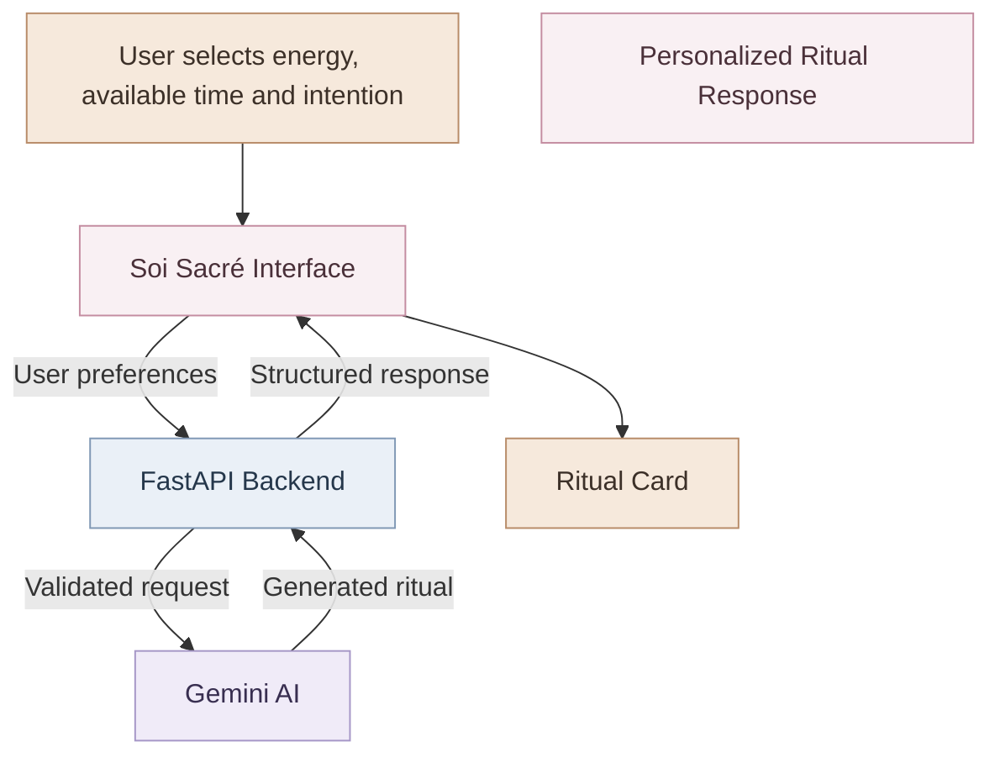
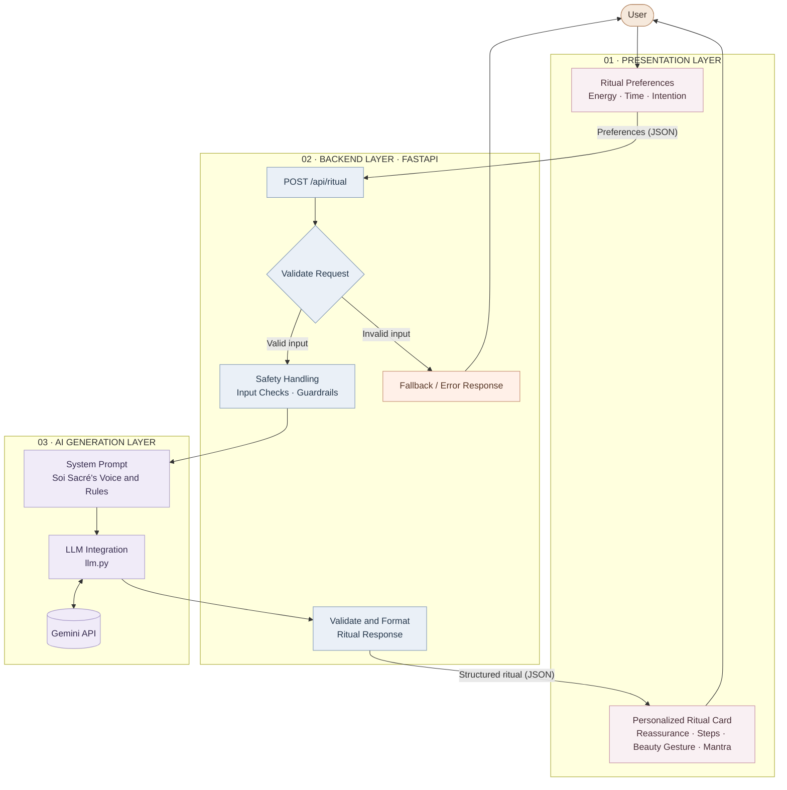

# Soi Sacré — System Architecture

## 1. High-Level Overview

This diagram presents the main user journey, from selecting ritual preferences to receiving a personalized self-care ritual.

## 2. Detailed Technical Architecture

This diagram describes the intended end-to-end architecture, including request validation, safety handling, AI generation, response formatting, and error handling.

## 3. Main Components

- **Presentation layer:** The planned user interface collects user preferences and displays the generated ritual.
- **FastAPI backend (`main.py`):** Exposes the `/api/ritual` endpoint and coordinates request processing.
- **Request schema (`schema.json`):** Defines the expected structure of ritual requests and responses.
- **Safety handling (`guardrails.py`, `guardrails.md`):** Contains safety-related logic and documentation for handling user input and sensitive situations.
- **System prompt (`system_prompt.md`):** Defines the assistant's role, tone, and ritual-generation instructions.
- **LLM integration (`llm.py`):** Connects the backend to Gemini for AI-generated rituals.
- **Example dataset (`examples.json`):** Contains eight real API input/output examples for review and testing.
- **Ritual card:** The planned interface component presents the title, reassurance, steps, beauty gesture, and mantra.

## 4. Current Implementation Status

**Implemented and tested**
- FastAPI backend and `/api/ritual` endpoint.
- Gemini API integration.
- Structured ritual generation.
- Eight real API examples saved in `examples.json`.

**Planned or requiring further verification**
- Complete frontend and integration with the Figma prototype.
- Final ritual-card layout and PNG export.
- End-to-end validation of safety and error-handling flows.

The diagrams distinguish the intended product architecture from the components already tested. Implementation status should be updated as additional features are completed.